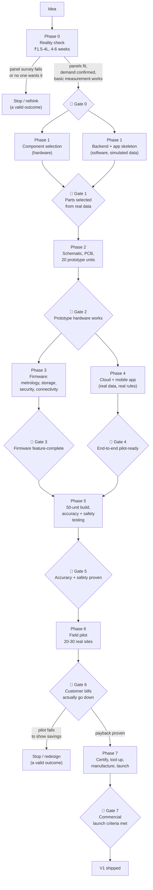
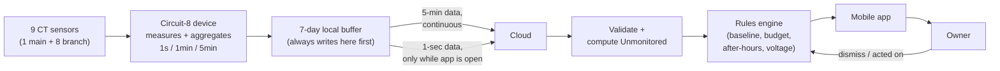

# Circuit-8 — Software & Hardware Requirements Specification (Master SRS)

**Document type:** Consolidated SRS — readable standalone, no other file required
**Product:** Circuit-8 (Electricity Intelligence Platform, V1)
**Status:** Planning complete, engineering not yet started (Phase 0)
**Audience:** Anyone — founder, new engineer, investor, or a first-time reader with zero context

> This file exists to answer one question completely: **what is this product, how does it work, and what does someone need to actually do — in order, hardware and software both — to build it.** Deeper detail on any single topic lives in the 15 source documents this file summarizes, but nothing here requires opening any of them.

---

## 1. What this product is

Circuit-8 is a small device that clips onto a shop, restaurant, clinic, or office's electrical panel in India and measures, separately, how much electricity each individual circuit is using — the fridge, the AC, the lights — not just one combined number on a monthly bill.

**The problem it solves:** an electricity bill arrives once a month, shows one total, and gives no explanation. By the time you see it, you can't do anything about last month's usage. Circuit-8 moves that visibility to *now*, broken down by circuit, so the owner can act before the next bill instead of being surprised by it.

**Who it's for:** small commercial electricity users in India — not premium homes (the payback math doesn't work for homes; see §10) — installed by a trained electrician, not a DIY kit.

**What it explicitly is not:** it does not switch anything off (no relay, no remote control — it only watches), it does not replace the official utility meter, and it does not use AI to guess what appliance is running — every circuit is exactly what you wired and labelled it as.

---

## 2. How it works — end to end

```
9 CT sensors  →  Circuit-8 device  →  Cloud  →  Mobile app  →  Owner acts
(1 main +        (measures,           (validates,   (shows live view,
 8 branch)        aggregates,          computes       cost, alerts)
                  buffers 7 days       "unmonitored",
                  offline)             runs rules)
```

1. **Sensing:** one clamp-on current sensor (CT) around the incoming main supply, and up to 8 more around individual labelled circuits inside the panel. No cutting wires, no rewiring.
2. **Measuring:** a metering chip inside the device reads all 9 channels continuously — current, voltage, power, energy — and a small onboard computer (MCU) aggregates that into 1-second, 1-minute, and 5-minute summaries.
3. **Storing locally first:** everything is written to a 7-day local memory buffer before it's ever sent anywhere. If Wi-Fi drops, nothing is lost — the buffer catches the cloud up once reconnected, without double-counting.
4. **Sending to the cloud:** 5-minute summaries are sent continuously; second-by-second data is only streamed while the owner has the app open and looking at "live view" (this keeps cloud costs sane — always-on 1-second streaming would cost roughly 2,700× more).
5. **Cloud processing:** the cloud checks the data is valid and belongs to the right customer, computes an "Unmonitored" channel (main total minus the 8 labelled circuits — an honesty check so the numbers always add up), and runs a set of fixed, explainable rules (not AI) to detect unusual patterns.
6. **The app:** shows live power per circuit, historical charts, a cost estimate (using the tariff rate the owner enters), a power-quality/outage log, and alerts — each alert states *why* it fired, not just a vague warning.
7. **The owner:** sees an alert, checks the flagged equipment, and either fixes something or calls an electrician. Their response (dismiss / acted on) feeds back into tuning the rules over time.

---

## 3. Feature set — V1 goal (what ships) vs. later (what's parked)

### V1 — Must ship
| Feature | What it does |
|---|---|
| Circuit-level measurement | Main + 8 branch circuits, measured independently |
| Unmonitored channel | Main − Σ(labelled circuits), shown honestly, never hidden |
| Historical data | 5-minute aggregates, viewable by day/week/month |
| Live view | 1-second updates, only while the app is open (session-gated) |
| 7-day offline buffer | Device keeps working and never loses data without internet |
| Monotonic energy counters | Energy readings never reset or go backward, even after outages |
| Tariff-based cost estimate | kWh × the rate you enter = a rupee estimate |
| Power-quality / outage log | Records voltage dips, spikes, and outages |
| Rule-based alerts | After-hours use, unusually long continuous run, voltage issues — deterministic, not AI |
| Installer commissioning flow | Electrician sets up and verifies the device through the app |
| Circuit labelling | Owner names each circuit (fridge, AC, lights, etc.) |
| Security | Secure boot, signed software updates, encrypted communication |
| Data export/deletion | Owner can export or delete their own data |

### V1 additions agreed in this conversation (new — not yet in the frozen scope, see §8)
| Feature | What it does |
|---|---|
| **Monthly budget target** | Owner sets a rupee target for the month; the app tracks running spend against it |
| **Limit-reached warning** | Alert fires once cumulative spend crosses the target |
| **Forward-looking prediction** | "If circuit X stays on for 1 more hour, you will exceed your target by ₹Y" — calculated live from current draw × time × tariff |
| **Equipment-deviation alert with cost** | Compares a circuit's current draw to its own 7-day history; if it's running abnormally high, the alert says "check this equipment" *and* states the extra cost in ₹/hour at the current draw |

### Parked for later versions (fully specified, not cancelled)
Three-phase support, relays/remote switching, AI-based appliance detection, multi-site/enterprise dashboards, solar/battery measurement, Circuit-16 (more channels) — each has its own document and a clear condition for when it gets "unparked."

---

## 4. Build workflow — from nothing to V1, hardware and software together

The project's own rule is: **never build before validating.** So step 1 isn't hardware or software — it's proving the idea is physically and commercially real, cheaply, before spending real money.

### Step 1 — Reality check (before any hardware or software commitment)
| # | Task | Cost |
|---|---|---|
| 1 | Survey ≥30 real electrical panels — does a 9-CT setup physically fit? | ₹40,000 |
| 2 | Interview 15–20 small business owners — do they actually want this? | ₹20,000 |
| 3 | Get a written regulatory-classification opinion | ₹50,000–2,00,000 |
| 4 | Decide on a lab-grade reference meter (buy/rent/borrow) | ₹10,000 |
| 5 | Buy one off-the-shelf metering evaluation board + a few CTs, test against a real load and a reference meter | ₹50,000 |
| 6 | Freeze the architecture and scope based on what was learned | ₹0 |

**Total: ₹1.5–4 lakh, 4–6 weeks.** If the panels don't fit or nobody wants this, stop here — don't build anything.

### Step 2 — Select real components (hardware) / build a working skeleton (software), in parallel
**Hardware track:**
- Benchmark 2+ metering chip candidates on real mains (this is the single most important part decision in the project — it determines everything downstream).
- Test CT samples for accuracy and physical fit.
- Select the MCU, radio module, flash memory, secure element, power supply.

**Software track (runs at the same time, doesn't wait on hardware):**
- Stand up a basic cloud backend (login, data ingestion, one chart) and a basic mobile app shell.
- Feed it *simulated* device data — prove one fake device's reading shows up on a chart, end to end.

**Checkpoint:** parts chosen from real measurements (not guesses), a second supplier found for each critical part, and a fake device's data flowing all the way into the app.

### Step 3 — Build real hardware
- Draw the circuit schematic, get it reviewed.
- Lay out the circuit board, build ~20 prototype units.
- Test that the enclosure physically fits real panels; run a basic electromagnetic-interference check.

### Step 4 — Write the firmware (overlaps with Step 3)
- Get the metering chip reading data reliably from the prototype boards.
- Add the 7-day local storage so it survives outages without losing data.
- Add secure boot and safe over-the-air updates, then get it talking to the cloud for real.

### Step 5 — Finish the backend and app (overlaps with Step 4)
- Real data ingestion, the "Unmonitored" math, the rules engine (including the two new alert types from §3).
- Installer commissioning flow, then the daily-use screens for the owner.

### Step 6 — Prove it actually works
- Build 50 units, test their accuracy against a proper lab-grade reference meter — this number decides if the product is real.
- Safety and interference certification testing, a 30-day continuous-run test.

### Step 7 — Pilot with real customers
- Install 20–30 units at real small businesses.
- Does the bill actually go down? This answers the real business question.

### Step 8 — Launch
- Certify the design, tool up the enclosure for mass production, build a few hundred units, ship.

**One sentence version:** survey panels + check regulations this week → benchmark the metering chip and build a fake-data app in parallel → build real hardware and firmware together → connect it to a real backend and app → prove accuracy in a lab → prove payback with real customers → then manufacture.

---

## 5. Whole project pipeline — build flow and runtime flow, end to end

There are two separate pipelines in this project, and it's easy to mix them up: the **build pipeline** (what the team does, once, over 14–18 months, to create the product) and the **runtime pipeline** (what the finished device does, every second, once it's installed). Both are mapped below.

### 5.1 Build pipeline — idea to launch



**Reading this pipeline:** every diamond (🚦) is a real go/no-go point, not a status update — the project is designed to be honestly killable at Gate 0 and Gate 6 in particular, because those are the two cheapest points to find out the idea doesn't work, before the expensive phases (hardware tooling, manufacturing) are reached.

### 5.2 Runtime pipeline — what a finished device does, continuously



**Reading this pipeline:** the device never depends on the cloud to keep measuring — the local buffer is written first, always, so a bad internet day never means lost data. The feedback arrow at the bottom (owner response back into the rules engine) is what lets alert thresholds improve over time instead of staying static forever.

### 5.3 The two pipelines side by side

| | Build pipeline | Runtime pipeline |
|---|---|---|
| Who runs it | The founding/engineering team | The device and cloud, automatically |
| How often | Once (14-18 months) | Continuously, every second, forever |
| What it produces | The product itself | Live data, alerts, and cost estimates for a customer |
| What can stop it | Gate failure (panels don't fit, pilot shows no savings) | Never stops — even offline, it keeps buffering locally |

---

## 6. Hardware — what's inside one device, and what it costs

| Component | Purpose | Cost (one unit, prototype qty) |
|---|---|---|
| 9 CT sensors (1 main + 8 branch) | Clamp-on current measurement, no wire-cutting | ₹1,350–2,700 |
| Metering chip (×2) | Reads current/voltage/power on all 9 channels | ₹700–1,200 |
| MCU + Wi-Fi/BLE radio module | Runs the firmware, connects to the cloud, pre-certified so no separate radio approval is needed | ₹250–400 |
| Secure element | Stores the device's identity in a way that can't be copied out | ₹40–90 |
| External flash memory (≥16 MB) | The 7-day offline buffer | ₹60–120 |
| Isolated voltage-reference + surge protection | Shared voltage sensing for all 9 channels, safely | ₹150–350 |
| Certified isolated power supply | Powers the electronics safely, separate from the dangerous mains side | ₹150–300 |
| Circuit board (PCB) | Prototype quantity | ₹300–700 |
| Enclosure | Fits inside real Indian panels, fire-rated | ₹200–600 |
| Fuses, connectors, wiring | ₹200–350 |
| Assembly | ₹300–600 |
| **Total — one device** | | **≈ ₹3,700–7,400** |

**Cost per unit drops with volume:**
| Volume | Cost per unit |
|---|---|
| ~20 (prototype) | ₹3,700–7,400 |
| 100 | ₹4,500–7,500 |
| 1,000 | ₹2,800–4,300 |
| 10,000 | ₹2,000–3,000 |

**One-time costs, not per-device** (needed once, before reliable production starts): lab-grade reference metering equipment (₹8–25 lakh), regulatory certification (₹3–10 lakh), circuit-board tooling (₹50k–1.5 lakh), enclosure tooling (₹3–12 lakh).

The single most expensive part on the device itself is the **CT sensor set** — the 9 clamps together cost roughly as much as everything else on the board combined.

---

## 7. Software architecture — how the pieces fit together

| Layer | What it does | How it's built |
|---|---|---|
| **Device firmware** | Reads the metering chip, aggregates data, stores locally, talks to the cloud securely | Runs on the onboard MCU |
| **Cloud ingestion** | Receives device data, checks it's valid and belongs to the right customer | Message broker + validation layer |
| **Data storage** | Keeps every measurement, safely and queryably | See §7 |
| **Rules engine** | Compares data to fixed thresholds/baselines and produces alerts — no AI, fully explainable | Runs on the cloud backend |
| **API** | Serves data to the app | A standard web API |
| **Mobile app** | One app, two roles (electrician for setup, owner for daily use) | Shared codebase, role-based permissions |
| **Admin tool** | Small internal tool for support staff to look up devices and manage software updates | Internal web tool |

---

## 8. Data storage — what's kept, and where

| Data | Where it lives | Why |
|---|---|---|
| Raw/aggregated power readings (5-min, historical) | Time-series database | Fast to query by time range, built for this kind of data |
| Customer accounts, device registrations, circuit labels, tariff settings | Relational database | Needs strict consistency (you can't have two customers sharing one device's data) |
| Software update files, data exports, rare diagnostic captures | Encrypted cloud file storage | Large files, doesn't need to be queried like measurements |
| Immutable ingestion log | Append-only log, kept separately from the "clean" data | So a data-processing mistake can always be traced back and fixed without losing the original reading |
| 7-day rolling buffer | On the device itself, in flash memory | Keeps working without internet |

**Key rule the whole system follows:** raw measurement data is never rewritten or silently corrected. If a number is later found to be wrong, a corrected version is stored *alongside* the original, with a record of why — never as a silent overwrite. This is what makes the "Unmonitored" honesty channel trustworthy: the customer can always trust that what they see isn't quietly smoothed over.

---

## 9. The two new features from this conversation — specified properly

These aren't in the original frozen scope, so per the project's own rule (no addition without a decision recorded), here's what they need:

**8.1 — Monthly budget target**
- Owner enters a rupee target for the month in the app.
- The app tracks cumulative spend (using the existing tariff-to-cost math) against that target.
- When the running total crosses the target, an alert fires: "you've reached your monthly limit."
- Forward-looking check: given a circuit's *current* power draw, the app calculates — if this stays on for another hour, what would the new running total be, and does that exceed the target? If yes: "keep this on for 1 more hour and you'll exceed your target by ₹Y."

**8.2 — Equipment-deviation alert with cost**
- Reuses the existing 7-day baseline calculation each circuit already builds.
- When a circuit's draw is meaningfully above its own normal pattern, the alert states: how far above baseline (%), a suggested action ("check this equipment"), and the extra cost in ₹/hour at the current draw (calculated as (current draw − baseline draw) × tariff rate).

**What this costs the project:** both reuse infrastructure already being built (tariff math, baseline calculation, the rules engine, the alert-with-evidence format) — so the honest addition is a small one: one new configuration screen, one new stored value (the monthly target), two new alert types, and their test cases. The two lowest-value "nice to have" items already in the plan (home-screen widget, carbon estimate) are the natural things to defer if the schedule needs to stay unchanged.

---

## 10. Why this design — the reasoning in brief

- **Small commercial sites, not homes:** a shop saves enough per month to pay back the device in 4–12 months; a home takes 29–70 months on the same saving — the business doesn't work for homes as the starting point.
- **No AI in V1:** rules need real, honest ground-truth data first. Shipping guesswork instead of measurement would undercut the entire "measured, not inferred" promise the product is built on.
- **No relay or remote switching, ever:** a device that can cut someone's power is a fundamentally different, riskier product. This one only watches.
- **Local buffering + honest "Unmonitored" channel:** both exist so the customer can always trust the number they're looking at, even during a bad internet day.
- **Session-gated live view:** streaming second-by-second data all the time would make cloud costs roughly 2,700× higher for no real benefit — most people don't watch live power 24/7.

---

## 11. Quick reference — the one-paragraph version

Circuit-8 is a clamp-on, 9-channel electricity monitor for small commercial sites in India, installed by an electrician, that measures each circuit separately, buffers a week of data locally so it never loses information, and reports live power, cost estimates, and rule-based (not AI) alerts through a mobile app — including, as of this conversation, a monthly budget target with forward-looking overage warnings and equipment-deviation alerts that state the extra cost in rupees per hour. The path to build it starts with cheap, physical reality checks (does it fit in a real panel, does anyone want it) before any hardware or software is built, then runs hardware component selection and a basic software skeleton in parallel, builds and tests real prototype hardware and firmware together, connects everything to a real backend and app, proves accuracy in a lab, and finally proves the business case with a real customer pilot before manufacturing at scale.